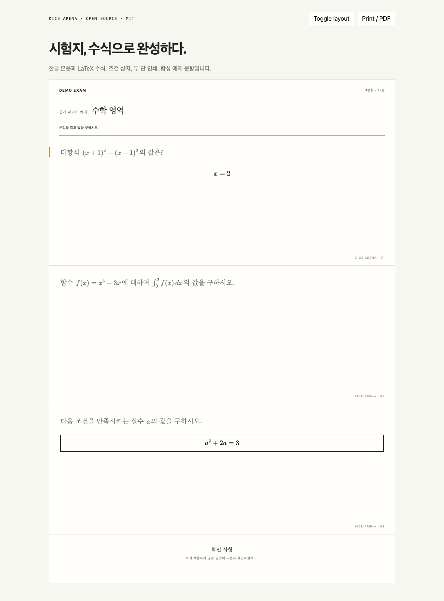

# @kicearena/exam-paper

Korean exam-style React documents: **LaTeX math, prose, condition boxes and adaptive A4 print layout**.

[MIT](LICENSE) · React 19 · KaTeX · ESM + TypeScript + scoped CSS · [](https://www.npmjs.com/package/@kicearena/exam-paper)



## What it does

- Renders paragraph, display-math, note and diagram blocks, including mixed Korean prose and math.
- Provides paged/continuous exam-paper and compact editor-preview components.
- Prepares two-column printable documents, expands tall/wide problems and fits overflowing math.
- Waits for fonts and images before invoking browser print; reports failed image preparation.

This is an HTML/KaTeX renderer and browser print layout, not a standalone TeX compiler. Scoring, answers, exam access, navigation, recovery and submission remain in your application. Supply your own brand slot, instructions, public content and fonts. Mark screen-only host chrome with `data-print-hide`; application shell selectors are not owned by this library.

## Install

Install directly from the public npm registry:

```sh
npm install --save-exact @kicearena/exam-paper@0.1.4
# or
bun add --exact @kicearena/exam-paper@0.1.4
```

```tsx
import { ProblemContent, MathHtml } from "@kicearena/exam-paper";
import "@kicearena/exam-paper/styles.css";

<ProblemContent
  problem={{
    number: 1,
    body: [
      {
        kind: "paragraph",
        text: "함수 {}를 생각하자.",
        inlineMath: ["f(x)=x^2"],
      },
    ],
  }}
/>;
<MathHtml latex={String.raw`\int_0^1 x^2\,dx`} displayMode />;
```

`ProblemBodyBlock` is a display schema. `ProblemChoices` renders inert numbered choices in document/public/print presentations; interactive answer controls remain in the host. `ExamDocumentPaper` receives prepared React content, item IDs, active ID, view and an `onItemRef` callback. `PrintableExamDocument` and `useExamPrint(printReady)` compose the printable copy. `brand` is caller-owned React content. `MathHtml` uses KaTeX with `trust:false`; invalid formulas remain visible as errors. Text placeholders `{}` bind the supplied `inlineMath` entries in order.

Theme variables include `--ink`, `--paper`, `--border`, `--muted`, `--gold`, `--font-sans`, `--font-serif` and optionally `--exam-document-font`. The default problem font falls back to Korean serif fonts. The demo supplies an existing OFL font with its own license; it is not included in the npm library.

## Showcase and development

```sh
bun install --frozen-lockfile
bun run demo
bun run check
bun run test
bun run build
bun run demo:build
```

The editable demo toggles document layout and prints synthetic math problems. Tests cover KaTeX errors, boxed math, prose/conditions, preview markup and print measurement/cleanup. Browser/PDF inspection is required when changing paper styles or fit logic.

## License

[MIT](LICENSE) © 2026 KICE Arena contributors. KaTeX and the demo font retain their respective licenses. This package is not an official examination authority publication.
